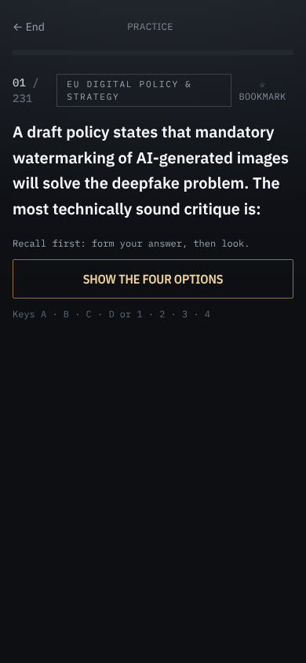
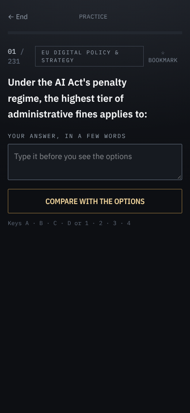
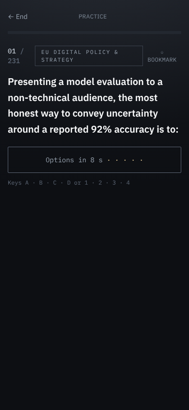

# EPSO AI Field Trainer — signature

The part of the EPSO AI Field Trainer that could only have come from Pavol. Nothing in
"Signature moves" is built before Pavol has picked it.

In one line: **ad fontes**. Learn the law from the law itself, test yourself before you are
told, and measure honestly.

## Lineage

| Source | Year | changes: |
|---|---|---|
| Erasmus, *De copia* and *De ratione studii*; the humanist commonplace book, later set out by Locke, *A New Method of Making Common-Place-Books* | 1512; 1511; 1706 | The candidate keeps a **commonplace book**: verbatim passages from the AI Act and the acquis, collected while practising and filed by act and article. They are passages met while working a problem, not someone else's summary. |
| *Ad fontes*; the glossed legal page (Accursius, *Glossa ordinaria* on the Corpus Juris) | 15th–16th c.; c. 1230 | Every governance and policy answer carries the passage of the official text that settles it, checked verbatim in CI. The explanation reads as a gloss set beside the text, with its reference. |
| Langdell's case method, Harvard Law School | 1870 | Questions are set as cases ("A start-up is placing an Annex III recruitment tool on the market…"). You answer by applying the article to the facts. |
| Aquinas, *Summa Theologiae*: the *quaestio* (objections, *sed contra*, *respondeo*, replies) | 1265–1274 | Each rationale names the tempting wrong option and says why it fails: the reply to the objection. |
| Ebbinghaus, *Über das Gedächtnis*; Roediger & Karpicke, "Test-Enhanced Learning" | 1885; 2006 | Practice is retrieval, not rereading. Missed questions come back on a schedule, and mastery means right twice in a row. |
| Slamecka & Graf, "The generation effect"; Lichtenstein, Fischhoff & Phillips, "Calibration of probabilities"; Brier, "Verification of forecasts…" | 1978; 1982; 1950 | Readiness is a calibrated range from first tries, never a flattering single number. The generation effect is the case for question-first mode (proposed below). |

## Refused

- **Toy design.** No confetti, mascots, cartoon emoji, or badges for their own sake. Candidates
  are professionals preparing for a career exam.
- **Streak anxiety.** The day count stays a quiet number. There are no loss warnings, no
  "don't break your streak" notifications, and no streak freezes.
- **Flattering scores.** No predicted pass, no guarantee, no invented cut-off. EPSO doesn't
  publish the cut-off, so neither do we. A mock built from questions you have already seen
  doesn't count as evidence.
- **Sources dressed up.** An unverified question never shows a quote as if the quote settled it.
- **Dark patterns.** No infinite feed, no daily-goal inflation, no paywall teasers. The app stays
  free.
- **The generic AI-app look.** No purple gradients, blobs, rounded-everything or "✨". No
  chatbot tutor answering from training data older than the law.

## Signature moves

| Move | What the user sees | From | Metric (event in kpi_event_map) | Status |
|---|---|---|---|---|
| **The cited answer** | Under each verified rationale: the verbatim passage, its article reference and a EUR-Lex link, and "Checked against the official text on …". The same passages appear on the 51 prerendered pages. | *Ad fontes*; the glossa | `key_action {action: 'source_open'}` from the answer, the commonplace book and the static pages (live since #10), divided by answered verified questions. Target ≥ 10%. | live (#2; metric #10); kept 2026-10-29 |
| **Likely score on a fresh paper** | A 10th–90th percentile range of 0–30 from first tries only, the chance of reaching 15/30, and the notice's real ranking rule (about 360 essays marked for 240 places). | Brier; Lichtenstein et al.; the testing effect | `exam_finish` score against the range sent with `start_exam` (`likely_low` / `likely_high`, since #11): the 80% range should contain the actual score about 80% of the time, over users with ≥ 2 mocks. | live (#3); kept 2026-10-29 |
| **The commonplace book** | "Copy to my commonplace book" on each cited passage. A view that files the passages by act and article, with the case they came from; exportable as text. | Erasmus, *De copia*; Locke | `key_action {action: 'commonplace_add'}`: the share of users with ≥ 5 entries, and their 7-day return rate against users with none. | live (#4); explained 2026-10-29, awaiting Pavol's pick |
| **Question first** | The stem appears alone; the options come only once you have formed an answer. Default B: write a few words, then compare. A setting on the Practice tab switches between none, A (tap), B (write) and C (wait). Never in the exam simulation. | Socratic questioning; the generation effect | `key_action {action: 'question_first', mode, wrote?, q, from}` when the options appear; `question_first` on `start_lesson` / `start_practice` / `start_review` / `start_bookmarks`; `key_action {action: 'question_first_set', mode, was}`. Then first-try accuracy on later reviews of the same questions, by mode against none. | approved 2026-10-29 (B, switchable); live (round 3) |

Status: proposed → approved (dated) → live → or changed / reverted.

### Proposal: question first

Built 2026-10-29 as Pavol picked: B is the default, and a setting switches between none, A, B
and C. It applies to practice, review, bookmarks and the daily lesson, never to the exam
simulation, which has to match the real format. The screenshots below are the original DOM
mockups at 390 px; the built screens are in `e2e/shots/question-first-*-390.png`.

- **Option A: tap to reveal.** The stem stands alone with "Show the four options". You form the
  answer in your head, then tap. 
  Cost: small, one flag in the question card plus a settings toggle; about half a day with
  tests.
- **Option B: write it first.** A short free-text box ("Your answer, in a few words") before the
  options. Your words are shown beside the key in the feedback. 
  Cost: medium, about a day. It is the strongest form of the generation effect, but it adds
  typing on a phone to every question, and the text is never scored.
- **Option C: timed hold.** The options fade in after a few seconds, with no tap.
  
  Cost: smallest. It is passive, so it forces no retrieval, and it slows down the candidates who
  already know the answer.

**Recommendation: A.** It keeps the retrieval step and costs one tap. It is easy to switch off
per session, and the metric can compare it fairly against normal mode. B is worth trying later
as a variant for missed questions only.

## Visual signature

The glossed legal page and the Official Journal. The law sits in the middle of the page; the
gloss and reference sit beside it in a smaller face. In the app:

- Source passages are set as quotations: italic, a rule on the left, and the reference (act,
  article) in small mono, the way an apparatus or margin note is set. This is the one
  signature element on the answer screen.
- Everything else uses the instrument-panel palette already in place (steel, brass,
  verdigris), held to the taste standard: four type steps, the accent twice per screen, AA
  contrast, and the phone contract. The reasoning tests use the same chrome, with figures
  drawn in the text colour.

## Founder lens

Articles II, VI and VIII bind this product.

- Verification runs in CI, and re-verification is a scripted pass when an act changes. The
  readiness model needs no server and no moderation, so the product does not take Pavol's
  evenings.
- The moat is a verification trail kept current against the law. It reaches people through
  findable, citable pages and an honest llms.txt. Unsourced questions are listed, not hidden.
- Ranges instead of promises, unverified questions shown as such, and no dark patterns. Where
  we don't know something, the screen says so.

## Decision log

| Date | Options shown | Pavol chose | Note |
|---|---|---|---|
| 2026-10-28 | Keep / change / revert for each live move: the cited answer, likely score on a fresh paper, the commonplace book | see 2026-10-29 | Hand-back `docs/review/2026-10-28.json` |
| 2026-10-28 | Question first: A tap to reveal · B write it first · C timed hold (recommend A) | see 2026-10-29 | Nothing built |
| 2026-10-29 | The cited answer: keep / change / revert | keep | "keep as it is" |
| 2026-10-29 | Likely score on a fresh paper: keep / change / revert | keep | "keep as it is" |
| 2026-10-29 | Question first: A · B · C · none | B, switchable | "B, but with options in settings to change between nothing A B C." Built in round 3: B by default, setting on the Practice tab, stored on the device. |
| 2026-10-29 | The commonplace book: keep / change / revert | explained, awaiting his pick | He wrote "I don't know what this is." Unchanged; a plain explanation and a 390 px screenshot go on the next decision page (`docs/review/2026-10-29-round3.json`). |
